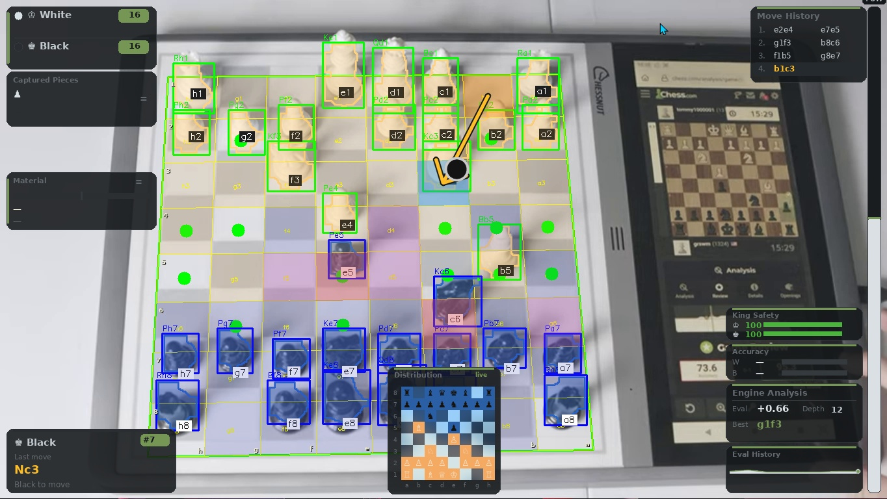
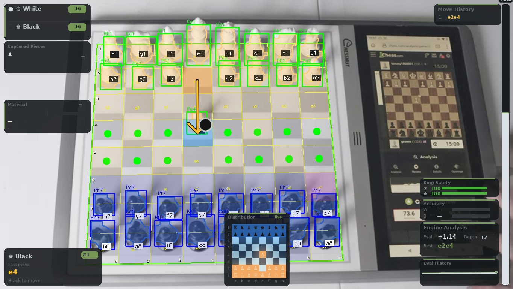
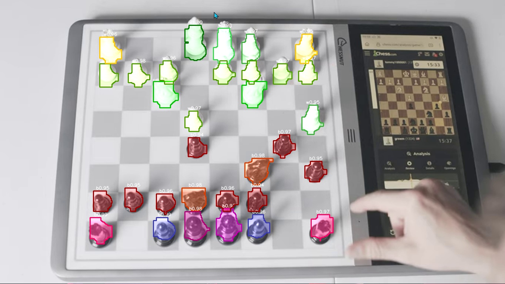
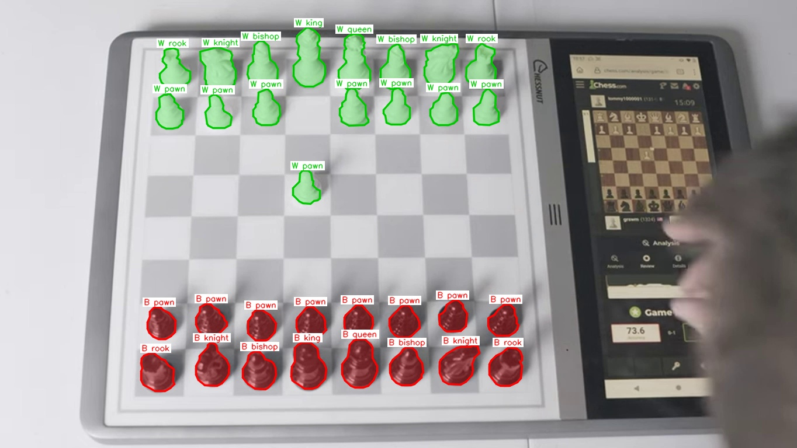
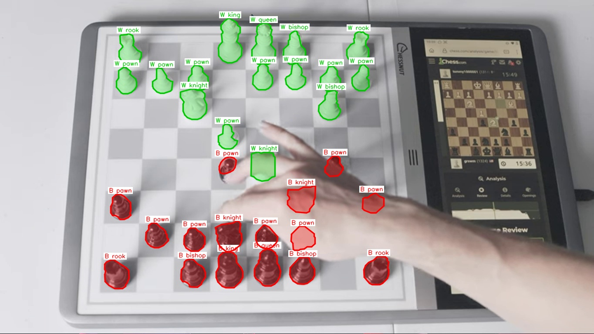

# ♟️ Chessnut Vision Tracker

**Point a camera at a physical chessboard and get a live, fully-annotated broadcast overlay** — piece detection, move tracking, PGN logging, and Stockfish analysis, all running on a single fine-tuned YOLO11-seg model.

No special board, no sensors, no manual input. Just a webcam over a [Chessnut Evo](https://chessnut.store/) board and a Python process.


*Live output after `1.e4 e5 2.Nf3 Nc6 3.Bb5 Nge7 4.Nc3` — every piece segmented and mapped to its square, move history, material balance, king safety, engine eval, and more, all updating in real time.*

---

## ✨ What it does

- 🎯 **Detects and segments every piece** on the board in one pass — tight pixel masks, not loose bounding boxes (see [Why segmentation, not boxes](#-why-segmentation-not-bounding-boxes) below).
- 🧭 **Maps pixels → chess squares** through a perspective-corrected homography, so it understands *real* board geometry even on a tilted camera.
- ♟️ **Tracks moves automatically**, including disambiguating between two pieces of the same type (two knights developing, for example) via ByteTrack identity, with a geometric-distance fallback when tracking breaks across a long hand occlusion.
- 🖐️ **Understands hand occlusion** — a hand-tracking layer (MediaPipe) keeps the system from misreading "hand covering the board" as a piece vanishing or moving.
- ♞ **Full chess-engine integration** — Stockfish evaluates every position, suggests best moves, grades move quality, and tracks accuracy, exactly like a chess.com broadcast overlay.
- 📝 **Logs the whole game** — move history, PGN export, FEN snapshots — from nothing but camera frames.

## 🎬 Move detection in action

| After `1.e4` | After `1.e4 e5 2.Nf3 Nc6 3.Bb5 Nge7 4.Nc3` |
|---|---|
|  |  |

Both frames are from the same unattended run — no manual input between them. The Move History panel, piece counts, and material balance all update live as the physical pieces move, including correctly telling apart the two white knights (`Nf3` then later `Nc3`) and the two black knights (`Nc6` then `Nge7`, disambiguated the same way chess notation would write it).

## 🖼️ The overlay, feature by feature

The live annotation stacks ~20 independent layers. Grouped by what each one tells you:

**What the camera sees**
| Overlay | What it shows |
|---|---|
| Board outline + grid | Calibrated board boundary; color = `STABLE` / `OCCLUDED` (hand in frame) / `SETTLING` |
| Piece boxes + labels | Raw per-piece detections, labeled with their mapped square — a debug view into the detector |
| Segmentation masks | Translucent piece silhouettes (amber = white, teal = black) |
| Hand skeleton | MediaPipe's 21-point hand landmark overlay, drawn whenever a hand crosses the board |
| Piece-count cards | Live count, read from the chess engine's *confirmed* state so it doesn't flicker on a single bad detection |
| Distribution mini-board | An 8×8 heatmap of exactly what's currently detected where |

**What happened**
| Overlay | What it shows |
|---|---|
| Move History panel | The full move log, numbered, like a scoresheet |
| Move arrow | Gold arrow from a move's start square to its end square |
| Ghost arrow | Faint green arrow showing what Stockfish would have played instead, when it disagrees |
| Last-move highlight | Tinted from/to squares |
| Capture flash | Brief flash on a square where a capture just happened |

**Position analysis** (this is the "chess engine" part)
| Overlay | What it shows |
|---|---|
| Engine Analysis panel | Stockfish eval, search depth, and its suggested best move |
| Eval bar | Same evaluation, as a vertical gauge |
| Eval History graph | That evaluation plotted across the whole game |
| Material panel | Point-value balance (Q=9, R=5, B=3, N=3, P=1), with a centered balance bar |
| Captured Pieces panel | Raw list of what's been captured by each side |
| Opening name | Recognized from a database of named opening sequences |
| King Safety panel | Rough exposure score for each king |
| Accuracy panel | Running % score of how close each side's moves are to engine-best |
| Board control heatmap | Tints each square by who currently attacks it |
| Threatened / check tint | Orange on attacked pieces, red on a king in check |
| Hanging-piece outline | Pulsing border on an attacked, undefended piece |
| Move-quality badge | `!` `!!` `?!` `?` `??` grading, chess.com-style |
| Critical-moment banner | A bigger flash for blunders / big evaluation swings |

## 🧠 Why segmentation, not bounding boxes


*Pixel-tight masks on an unseen frame — none of these were in the training set.*

The original pipeline used YOLO object detection (boxes) and handed those boxes to SAM2 as prompts for pixel masks. On this board that bled badly: the boxes were loose enough that the refined masks regularly spilled onto neighboring squares, corrupting square assignment.

The fix was to stop prompting a second model entirely and train a single YOLO11-seg model that outputs tight masks directly, fine-tuned on hand-labeled frames of the actual physical board and pieces. Confirmed on frames the model never trained on — including under partial hand occlusion.

## 🖐️ Hand-labeled from scratch, no GPU required


*161 piece instances traced by eye and edge-snapped with classical CV (OpenCV GrabCut) — no SAM, no GPU, no manual Roboflow labeling.*

[`chessnut_evo_seg_dataset/`](chessnut_evo_seg_dataset) (21 frames, 671 piece instances, all 12 classes balanced 16/16 white/black) was built by:

1. Reading each piece's class and square directly off zoomed frame crops.
2. Hand-tracing a rough polygon per piece.
3. Snapping each polygon's edges with GrabCut (classical computer vision, CPU-only — no SAM3/LocateAnything/other GPU-hungry labeling models).
4. Propagating approved frames to new ones via a homography fit over known piece positions, then re-snapping — so later frames reuse earlier work instead of starting from scratch.

**Occlusion is labeled deliberately, not avoided:**


*A pawn ~85% covered by a hand, labeled down to its actually-visible sliver only.*

A handful of frames include a hand partially covering a piece, labeled down to the exact visible pixels (never guessing the hidden part, and dropping a piece entirely from a frame's labels if it's **fully** hidden — a hallucinated polygon is worse than no label). This teaches the model to keep reporting a square as occupied while a hand passes over it, instead of a piece appearing to vanish mid-move.

## ⚙️ How it works

```
 camera frame
      │
      ▼
 YOLO11-seg (chessnut_evo_ft_v1)  ──▶  class + box + mask, one pass
      │
      ▼
 ByteTrack                         ──▶  stable per-piece identity across frames
      │
      ▼
 Perspective-corrected homography  ──▶  pixel → chess square (a1-h8)
      │
      ▼
 Two-tier move detector
   Tier 1: a single ByteTrack identity's square stably changes → unambiguous move
   Tier 2 (fallback): square-occupancy matching, nearest-candidate first,
           for when a long hand occlusion breaks track identity
      │
      ▼
 python-chess + Stockfish           ──▶  legality check, eval, PGN, move quality
      │
      ▼
 ~20-layer annotation renderer      ──▶  the overlay shown above
```

Board corner calibration is a notable gotcha: the usual OpenCV chessboard-pattern detectors (`findChessboardCornersSB`, classic `findChessboardCorners`) assume a sharp, printed black/white checkerboard. They fail 100% of the time on this board's light-grey/white squares. Corners are instead computed once from a homography fit over hand-labeled piece positions — and critically, must use the *exact* anchor convention the live pipeline uses (bottom-most mask pixel), not an averaged point, or every square comes out shifted by about one row.

## 📦 Repo layout

```
chess_detection_bbox.py                   # live detection + tracking + overlay pipeline
chess_yolo11seg_train.py                  # base segmentation training (full chess_seg_dataset)
chessnut_evo_yolo11seg_finetune.py        # fine-tune on chessnut_evo_seg_dataset, warm-started
chessnut_evo_seg_dataset/                 # 21 hand-labeled frames, YOLO-seg format
models/
  best.pt                                 # chessboard bounding-box detector
  chessboard_det.pt                       # alternate chessboard detector checkpoint
runs/segment/chessnut_evo_ft_v1/weights/
  best.pt                                 # the fine-tuned piece segmentation model
docs/images/                              # README screenshots
```

## 🚀 Setup

```bash
pip install -r requirements.txt
# Stockfish is a system binary — see requirements.txt for install instructions
```

`chess_detection_bbox.py`'s `main()` has the video path, model paths, and board corners hardcoded for the original capture setup (`chessnut_evo.mp4`, a fixed-camera recording of a Chessnut Evo board). To point it at your own footage:

1. Update `video_path`, `piece_model_path`, `chessboard_model_path`, and `seg_model_path` near the top of `main()`.
2. Re-derive `_locked_corners` for your camera angle — either let the built-in pattern/LSD detectors try (they work fine on higher-contrast boards), or hand-calibrate the same way this project did (see [Hand-labeled from scratch](#-hand-labeled-from-scratch-no-gpu-required)).
3. Set `tracker.square_mapper.white_at_bottom` to match your camera's orientation.

```bash
python chess_detection_bbox.py
```

Annotated frames are written out individually plus assembled into a video; a move log and PGN are written alongside.

## 🏋️ Training your own segmentation model

```bash
python chess_yolo11seg_train.py                 # base model, COCO-pretrained
python chessnut_evo_yolo11seg_finetune.py        # fine-tune for a new board/piece set
```

The fine-tune script warm-starts from the base model with a low learning rate and a frozen backbone — appropriate for adapting to a new board/lighting setup from a small (dozens, not hundreds, of frames) labeled set, rather than training from scratch.

## ⚠️ Known limitations

- Board calibration (`_locked_corners`) is specific to one fixed camera position. Moving the camera requires recalibration.
- Heavy, unfamiliar occlusion patterns can still produce a fragmented, low-confidence detection instead of one clean mask — the training set includes only a handful of occlusion examples.
- The move detector assumes standard moves; castling/en passant/promotion aren't specially handled in the UCI move construction.

## 🙏 Built with

[Ultralytics YOLO11](https://github.com/ultralytics/ultralytics) · [Supervision](https://github.com/roboflow/supervision) (ByteTrack) · [Stockfish](https://stockfishchess.org/) · [python-chess](https://python-chess.readthedocs.io/) · [MediaPipe](https://developers.google.com/mediapipe) · [OpenCV](https://opencv.org/)
